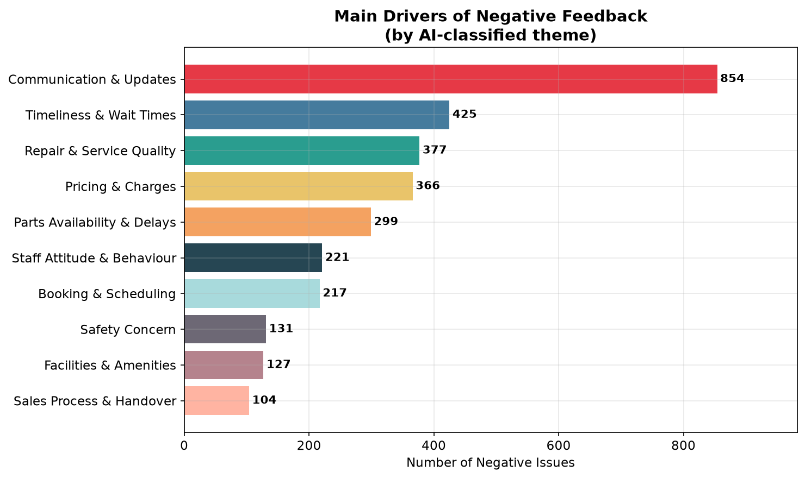
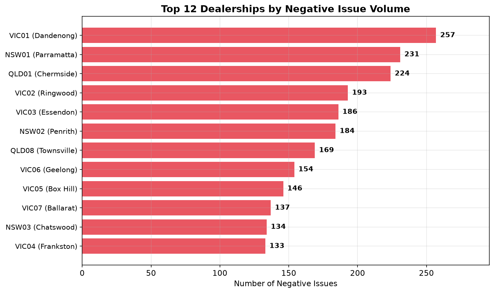
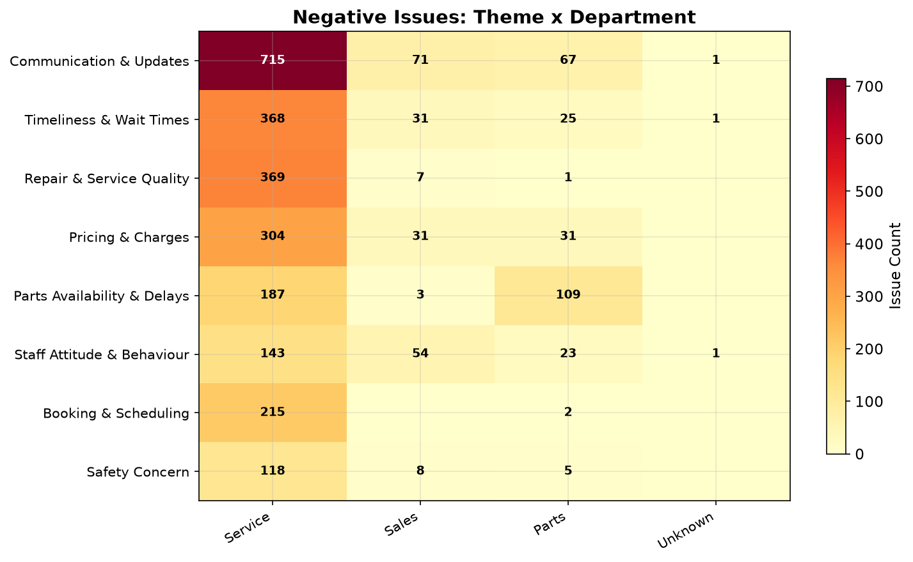
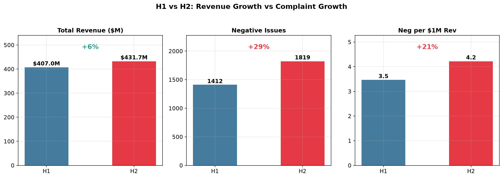
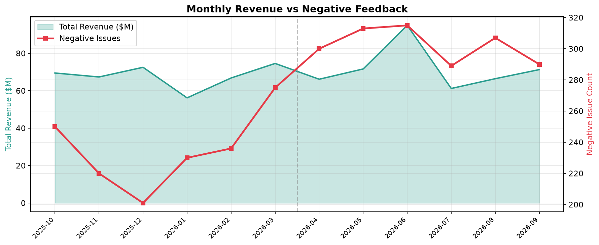
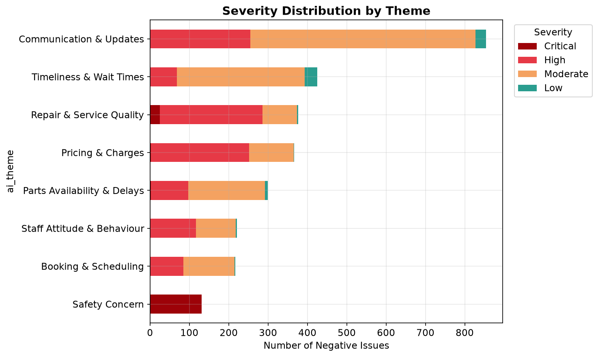
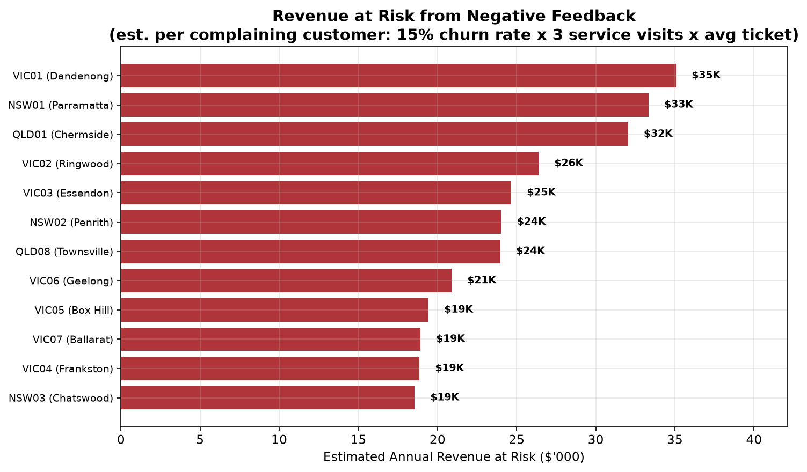

# Kestrel Motor Group — Customer Feedback: Data & AI Challenge

Kestrel's head office had 52 customer-feedback spreadsheets from 24 dealerships (Oct 2025 – Sep 2026) and no common template, so it couldn't answer basic questions about customer experience. This repo turns those files into a single traceable dataset, uses AI to turn the free-text comments into themes, sentiment and severity, and answers the Head of Customer Experience's three questions.

**Headline:** 7,045 feedback records produced 3,231 negative issues. Communication is the biggest driver by volume (26%), but Safety is the No.1 priority: 131 issues, all Critical, where one serious incident could cost more than everything else combined. Parts Availability complaints tripled between H1 and H2. Complaints grew faster than revenue: negative issues per $1M revenue went up 21%.

**How this README is organised**
1. [Codebase overview](#codebase-overview): where things live and how to run them
2. [Approach, assumptions & solution](#approach-assumptions--solution), including tech choices
3. [Observations about data quality](#observations-about-data-quality)
4. [Dealer Customer Satisfaction Performance Analysis](#kestrel-motor-group--dealer-customer-satisfaction-performance-analysis)
5. [Insights & recommendations across dealerships](#insights--recommendations-across-dealerships)
6. [AI usage overview](#ai-usage-overview)

Sections 2–4 also exist as standalone files: [`report/approach_overview.md`](report/approach_overview.md), [`report/data_quality_observations.md`](report/data_quality_observations.md) and [`report/business_answers_q4.md`](report/business_answers_q4.md).

---

# Codebase overview

```
.
├── README.md                      ← this report
├── report/
│   ├── approach_overview.md       ← approach, assumptions, tech choices
│   ├── data_quality_observations.md ← data quality findings
│   ├── business_answers_q4.md     ← customer satisfaction performance analysis
│   └── charts/                    ← chart PNGs used in the report
└── code_and_data/                 ← all code, inputs and outputs (run everything from here)
    ├── feedback/                  ← the 52 original source files (unchanged)
    ├── reference/                 ← dealerships.csv, monthly_revenue.csv
    ├── docs/                      ← source_registry.yaml (per-file manifest), issues_and_decisions.md
    ├── consolidate.py             ← 1. stack all 52 files into one raw table with provenance
    ├── validate_consolidation.py  ← 1b. check file/sheet coverage and row counts vs source
    ├── clean.py                   ← 2. 16-step cleaning, validation, PII redaction
    ├── validate_clean.py          ← 2b. check row accounting, integrity, encoding
    ├── diagnose_unmapped.py       ← helper: list source columns that weren't mapped
    ├── ai_analysis_optimised.py   ← 3. AI classification (Haiku → Sonnet) + theme strategies
    ├── generate_charts_for_q4.py  ← 4. charts + report_stats.md (all computed numbers)
    ├── generate_excel.py          ← 4b. Excel workbook of charts (kestrel_feedback_charts.xlsx)
    ├── consolidated_raw.csv       ← output of step 1
    ├── consolidated_clean.csv     ← output of step 2
    ├── data_quality_errors.csv    ← every logged data quality issue
    ├── rejects.csv                ← removed rows, with reason codes
    ├── validation_report.txt      ← output of step 1b
    ├── report_stats.md            ← output of step 4
    └── ai_output/                 ← AI results, taxonomy, word clouds, validation sample
```

### How to run

Requirements are Python 3 with `pandas`, `numpy`, `openpyxl`, `matplotlib`, `wordcloud` and `anthropic`. The AI step also needs `ANTHROPIC_API_KEY` set as an environment variable. All paths are relative, so run every command from inside `code_and_data/`. The `-X utf8` flag stops the scripts crashing on Windows consoles when they print characters like →:

```bash
cd code_and_data
python -X utf8 consolidate.py --feedback-dir feedback --output consolidated_raw.csv
python -X utf8 validate_consolidation.py --consolidated consolidated_raw.csv --feedback-dir feedback --dealerships reference/dealerships.csv
python -X utf8 clean.py --input consolidated_raw.csv --output consolidated_clean.csv
python -X utf8 validate_clean.py --raw consolidated_raw.csv --clean consolidated_clean.csv --rejects rejects.csv --errors data_quality_errors.csv
python -X utf8 -I ai_analysis_optimised.py --input consolidated_clean.csv --test   # 40-row dry run
python -X utf8 -I ai_analysis_optimised.py --input consolidated_clean.csv          # full run (paid API calls)
python -X utf8 generate_charts_for_q4.py
python -X utf8 generate_excel.py --issues ai_output/ai_issues.csv --main ai_output/consolidated_clean_ai.csv
```

Note: `generate_charts_for_q4.py` writes its PNGs to `code_and_data/charts/`. If you rerun it, copy them to `report/charts/` so the report picks up the new versions.

---


<div style="page-break-after: always;"></div>

# Approach, Assumptions & Solution

## Approach

The pipeline runs in three phases: **Data preparation → AI classification → Analysis & reporting**.

- **Data preparation** (sections 1–2): consolidate, clean and validate 52 inconsistent files into one trusted, traceable dataset.
- **AI classification** (section 3): turn every free-text comment into themes, sentiment and severity.
- **Analysis & reporting** (section 4): link feedback to revenue and turn it into prioritised, costed recommendations.

### 1. Source registry & consolidation

Before writing any code, I manually inspected all 52 files — opening each one, noting column names, header positions, sheet structures, and quirks. This produced `source_registry.yaml`: a per-file manifest documenting formats, column maps, anomalies, and decisions.

Initial observations:
- **File structure:** 52 .xlsx and .csv files from 24 sites, with no shared layout. Some sites send a file per month or quarter, others one running workbook with up to 12 sheets. Headers don't always start on row 1, banners and notes sit above them, delimiters differ, and one file covers two dealerships.
- **Metadata:** column names, department labels and site identifiers all vary by file. Rating scales are often unstated and differ (1–5, 1–10, inverted, text, stars), and dates come in many formats (AU, ISO, Excel serials, "3 weeks ago", "early Apr").
- **Data quality:** blank, test and subtotal rows are mixed in with real feedback, there are duplicates and superseded file versions, departments and ratings are sometimes missing, and customers' personal details appear in free-text comments.

The file-by-file quirks this caught (template changes mid-file, inverted scales, embedded subtotals, duplicate file versions, a shared two-site file) are listed under *Observations about Data Quality*.

I defined a set of canonical columns (date, department, rating_raw, comment, customer_name, etc.) and mapped every source column across all 52 files to them. Unmapped columns were preserved with an `_unmapped_` prefix rather than silently dropped. Every row carries full provenance (site_code, source_file, source_sheet, source_row) so it traces back to its exact origin.

### 2. Cleaning & validation

A 16-step pipeline in `clean.py`, where each step logs what it changed and why. It removes junk rows (blanks, banners, test submissions), parses every date format, maps departments to Sales | Service | Parts | Unknown, puts all ratings on a 1–5 scale (5 = best), splits the shared North QLD file by site, removes duplicates, and hashes or redacts personal details.

Every transformation logs to `data_quality_errors.csv` (step, error code, original value, action taken). Rejected rows go to `rejects.csv` with a reason code. Nothing is silently discarded.

Two separate validation scripts verify the work:
- `validate_consolidation.py` — file coverage, row counts vs source files, sheet coverage, provenance completeness
- `validate_clean.py` — row accounting (raw = clean + rejects + dedup), untouched columns preserved, no mojibake, rating round-trip, no unexpected nulls, feedback_id uniqueness, date range sanity

### 3. AI classification

Two-pass architecture using the Anthropic API:

- **Pass 1 (Haiku):** classifies every comment with sentiment + primary theme. Cheap and fast — covers all ~5,300 comments.
- **Pass 2 (Sonnet):** detailed issue-level analysis on negative/mixed comments only (~35% of rows). Extracts multiple issues per comment, severity, evidence quotes, and responsible department.
- **Pass 3 (Sonnet):** one call per theme with all the evidence aggregated — produces 3 prioritised actions per theme instead of repetitive per-issue recommendations.

- **Why Haiku + Sonnet:** most comments only need a sentiment and theme label, which Haiku does well at a fraction of the cost. Sonnet's stronger reasoning is kept for the ~2,400 negative/mixed comments, where separating multiple issues, severity and responsibility matters.
- **Why ~5,300 comments, not 7,045 rows:** 1,676 rows have no comment (almost all are rating-only feedback), so there is nothing to classify. They skip the AI but stay in the dataset for rating analysis.
- **Why the API, not a chat window or Excel:** 5,000+ comments are too many to paste into a chat reliably, and Excel can't interpret free text. The API makes the run scripted and repeatable, redacts personal details before anything is sent, returns structured output that loads straight back into the dataset, and supports batching, caching and resuming from checkpoints.

The theme taxonomy (13 themes, ~50 sub-themes) was built from an initial sample of the data, not imposed top-down. It covers the operational categories that actually appear: Communication, Pricing, Timeliness, Staff Attitude, Repair Quality, Safety, Booking, Parts Availability, Vehicle Knowledge, Sales Process, Facilities, plus catch-alls for general positives and unclear comments.

Cost controls: prompt caching on system prompts, batches of 30, trimmed prompts (~65% shorter), and the two-pass design (only ~35% of rows hit the expensive model). Estimated ~85–90% cost reduction vs sending everything to Sonnet.

A validation sample of 250 stratified comments is exported for human review.

### 4. Analysis & reporting

`generate_charts_for_q4.py` joins the AI-classified feedback with `monthly_revenue.csv` to produce revenue-contextualised metrics: negative issues per $1M revenue, per 1,000 service jobs, estimated revenue at risk per dealership, H1-vs-H2 comparisons. Outputs 13 charts and a `report_stats.md` with every computed number in copy-pasteable tables.

---

## Key Assumptions

| Assumption | Rationale |
|---|---|
| **Hunter Motors = Newcastle (NSW05)** | No Newcastle file existed; Hunter Motors wasn't in dealerships.csv. Treated as Newcastle per implied data owner instruction. Flagged for confirmation. |
| **Vague dates → mid-point estimates** | Ipswich's hand-typed dates ("early Apr" → Apr 10, "wk5 Mar" → Mar 28, "mid Nov" → Nov 15). Marked as `date_quality = approximate`. |
| **Relative dates from end of reporting period** | "3 weeks ago" calculated from 30 Sep 2026. Also marked approximate. |
| **Geelong inverted scale: `6 - raw` (2025 sheet only)** | Banner says "1 = Excellent, 5 = Poor". Flipped to match the group convention (5 = best). The 2026 sheet already uses 5 = best. |
| **Ringwood 1–10 → 1–5 via `ceil(raw / 2)`** | New template from Feb 2026 uses 1–10. Ceiling division preserves the sentiment direction (1–2 → 1, 9–10 → 5). |
| **Toowoomba Q4 2025 summary excluded** | Pivot table with no individual records. Creates a known coverage gap for Q4 2025. |
| **Chermside: keep FINAL v2, drop FINAL** | v2 is assumed to be the corrected version. |
| **Southport Google reviews: kept but flagged** | Different population (self-selected public reviews). `from_google_southport` flag allows filtering. |
| **Revenue at risk: complaining customers × 15% churn × 3 visits × avg ticket** | Conservative order-of-magnitude estimate, not a forecast. Industry churn benchmarks for dissatisfied customers range 10–30%. |
| **Safety liability ($2.25M per serious-injury claim, TAC average), DMS fix cost ($15–30K), fleet downtime ($500–1,500/day)** | Assumptions; these cannot be calculated from the data provided. |
| **PII treated as real** | Per the brief. All PII columns hashed; comments scanned and redacted before any API calls. |

---

## Solution

### Design philosophy

Three principles throughout:

1. **Trace everything.** Every row carries provenance back to its source file, sheet, and row number. Every cleaning decision is logged with the original value and what was done. Rejected rows are kept in a separate file with reasons — not deleted.
2. **Validate every stage.** Separate validation scripts check consolidation and cleaning independently. The AI classification has a human-review sample. No stage is trusted without a check.
3. **Separate raw from clean.** The consolidation step does zero transformation — just column renaming and stacking. Cleaning is a separate, auditable pipeline. This means you can re-run cleaning with different rules without re-reading 52 source files.

### Tech choices

- **Python + pandas** — the data fits comfortably in memory (~5K rows), so there's no need for Spark/Dask. Pandas is the standard for this kind of tabular wrangling.
- **Anthropic API (Haiku + Sonnet)** — two-pass design matches cost to value. Sentiment/theme classification is a commodity task (Haiku is fine); issue extraction from ambiguous negative comments benefits from a more capable model.
- **No database** — at this scale, CSVs are simpler, more portable, and easier to inspect. A database would add infrastructure overhead without solving a real problem.
- **matplotlib for charts** — nothing interactive needed; static PNGs for a report. No point pulling in Plotly/D3 for bar charts.
- **YAML for the source registry** — human-readable, easy to diff, and captures the messy reality of 52 files with different formats better than code comments would.

---

## Learning & Reflection

- **Inspecting the files by hand first paid off.** The source registry caught most quirks before any code was written. The ones it missed, such as sheet counts and Chermside's column names, were things I hadn't checked.
- **AI is fast, but only as good as its grounding.** It worked well from my notes and column headers, and went wrong when it had to guess about data it couldn't see.
- **A privacy miss I caught.** The comment redaction covered phone numbers, emails and registrations, but not names at the start of staff-transcribed comments, so 55 customer names reached the API before I found them. Lesson: test redaction on real comment formats before any API call.
- **Validate the write-up, not just the data.** A final review found report figures that didn't match the data (typed-in value-at-risk numbers, wrong site codes). These are now calculated or corrected.
- **Volume isn't priority.** Communication has the most complaints, but Safety carries the biggest risk. Ranking by impact changed the recommendation.
- **Next time:** agree a single feedback template with the dealerships, since most of the cleaning effort came from not having one.


<div style="page-break-after: always;"></div>

# Observations about Data Quality

**Root cause: there is no data management process across the group.** There are no standard master data or data definitions, no common structure, format or template, and no quality control at the point of data entry. Files are collected and submitted manually, with no standard for what is sent. At head office there is no quality control, consolidation, analysis or reporting, no action planning or tracking, no governance or performance accountability, no integration or automation, and no continuous improvement. The issues below are symptoms of these gaps.

## The shape of the problem

52 files, zero shared template. Every dealership evolved its own spreadsheet over time, so the incoming data varied in column names, column order, rating scales, date formats, sheet structure, and what counted as a "row." The source registry documents the per-file reality; the cleaning pipeline logged 674 data quality errors and rejected 32 rows.

## Structural inconsistencies across files

No two dealerships used exactly the same schema. Specific issues:

- **Dandenong (VIC01)** — header row shifts down by one in the May sheet due to an extra annotation row.
- **Essendon (VIC03)** — no department column; instead each department (Sales, Service, Parts) is on its own sheet, so department was taken from the sheet name.
- **Frankston (VIC04)** — subtotal rows embedded in data ("Total Mar 2026", "Grand Total") that parse as valid records. 12 of these were caught and rejected.
- **Ringwood (VIC02)** — template changes mid-file at row 36 in Q1 2026. Column names change, and the rating scale jumps from 1–5 to 1–10.
- **North QLD (QLD07/QLD08)** — two dealerships share one file, distinguished by a "Site" column with inconsistent abbreviations (ROK, ROCK, ROCKY, TSV, T'VILLE, etc.).
- **Chermside (QLD01)** — two versions of the Q1 2026 file exist (FINAL and FINAL v2). Kept v2, dropped FINAL.
- **Parramatta (NSW01)** — schema drifts across quarters with columns appearing and disappearing.
- **Shepparton (VIC09)** — site appears to have closed mid-year; sparse data, 1 unparseable date, 1 missing rating, 1 missing department.

## Date quality

31 date-related errors across four sites:

- **Frankston (VIC04):** 12 unparseable dates, all from the subtotal/summary rows that don't represent real feedback events.
- **Ipswich (QLD03):** 10 approximate dates from hand-typed entries like "wk5 Mar", "early Apr", "mid Nov". These were converted to mid-point estimates (e.g. "early Apr" → Apr 10) and flagged as `date_quality = approximate`.
- **Southport (QLD04):** 8 approximate dates from Google review relative timestamps ("3 weeks ago", "2 months ago"), resolved from the end of the reporting period (30 Sep 2026).
- **Shepparton (VIC09):** 1 unparseable date.

All approximate dates are flagged so downstream analysis can exclude or weight them if needed.

## Rating scale chaos

Every site nominally used a 1–5 scale, but:

- **Geelong (VIC06)** inverted it on its 2025 sheet: 1 = Excellent, 5 = Poor. A banner row in the spreadsheet says so. Normalised via `6 - raw`. The 2026 sheet uses the normal scale (5 = best) and is left as is.
- **Ringwood (VIC02)** switched to 1–10 from February 2026 onwards. Normalised via `ceil(raw / 2)`.
- **Tamworth (NSW07)** used text ratings ("Good", "OK", "Bad") instead of numbers. 10 rows had no rating at all — the highest count of missing ratings for any site.
- **Southport (QLD04)** Google reviews used star emoji (★★★½☆). Parsed to numeric.
- **Shepparton (VIC09):** 1 missing rating.

11 total `RATING_MISSING` errors (10 Tamworth, 1 Shepparton).

## Department mapping

~40 raw department variants across all sites, mapped to four canonical values: Sales, Service, Parts, Unknown.

21 `DEPT_MISSING` errors:
- **Frankston (VIC04):** 12 — all from the subtotal rows (no department on a "Grand Total" line).
- **Southport (QLD04):** 8 — Google reviews have no department context.
- **Shepparton (VIC09):** 1.

Essendon (VIC03) has no department column, but its workbook has one sheet per department, so every row still gets a department from its sheet name. The only `Unknown` departments in the clean data are the 8 Southport Google reviews.

## PII in free-text comments

The largest category: **611 instances** of personally identifiable information found inside comment text. This includes names, phone numbers, email addresses, and registration plates that customers or staff typed into the free-text field.

23 of 24 sites had at least some PII leakage. The worst offenders:

| Site | PII instances |
|---|---|
| Essendon (VIC03) | 67 |
| Dandenong (VIC01) | 54 |
| Parramatta (NSW01) | 46 |
| Penrith (NSW02) | 44 |
| Ringwood (VIC02) | 43 |
| Box Hill (VIC05) | 35 |
| Ballarat (VIC07) | 35 |
| Chatswood (NSW03) | 35 |
| Newcastle (NSW05) | 33 |

All PII was redacted before any data left the pipeline — name/phone/email/rego columns were SHA-256 hashed, and comments were regex-scanned and scrubbed before being sent to the AI classification API. One gap was caught late: 55 comments at Essendon and Ipswich began with the customer's full name, which the original patterns missed. These were only redacted after the AI run (see AI usage overview).

This is logged as severity `info` (not a data error, but a privacy hygiene finding). All 611 instances were actioned.

## Rejected rows

32 rows were removed from the clean dataset, all with documented reason codes:

| Reason | Count | Source |
|---|---|---|
| `all_data_columns_null` | 14 | VIC02 (1), VIC04 (12), VIC09 (1) — empty rows, mostly from Frankston's padded spreadsheet |
| `frankston_subtotal` | 12 | VIC04 — embedded summary rows like "Total Mar 2026" |
| `test_submission` | 4 | QLD04 — entries like "testing new form", "asdf" |
| `banner_or_marker` | 1 | VIC02 — a formatting row ("***") |
| `rating_std_comment_date_parsed_all_blank` | 1 | VIC09 — a row with no usable data after cleaning |

All rejected rows are preserved in `rejects.csv` with full provenance. Nothing was silently dropped.

A further 216 rows were removed as duplicates: 112 from Chermside's superseded Q1 FINAL file, and 104 exact duplicates across sites (dedup counts are printed by `clean.py` and checked by `validate_clean.py`).

## Coverage gaps

- **Toowoomba (QLD06):** Q4 2025 data exists only as a pivot-table summary — no individual feedback records. This creates a known gap for Oct–Dec 2025.
- **Southport (QLD04):** Google reviews are a different population (self-selected public reviews vs dealership-collected feedback). Kept but flagged with `from_google_southport = True` so they can be filtered in analysis.

## Summary

Of the 674 logged errors, 640 (95%) are severity `info` (mostly PII redactions — things handled automatically). Only 34 (5%) are `warning` severity, covering unparseable or approximate dates, missing ratings, and missing departments. The data is messy but tractable — the problems are well-understood and concentrated in a handful of sites.


<div style="page-break-after: always;"></div>

# Kestrel Motor Group — Dealer Customer Satisfaction Performance Analysis

## Business context

Kestrel Motor Group runs 24 dealerships across Victoria, New South Wales and Queensland, selling and servicing several vehicle brands. Over the year it sold 16,011 vehicles and completed 200,249 service jobs, for \$838.7M in revenue. Around 89% of that revenue comes from vehicle sales, but the service relationship is what brings customers back. Each dealership records feedback in its own format, so head office has had no group-wide view of what customers are saying. This analysis brings that feedback together to show what drives dissatisfaction, how it has changed, and where to act first.

**How priorities are ranked:** Safety first, then financial impact, then customer loyalty, then efficiency.

> **Dataset:** 7,045 feedback records across 24 dealerships (Oct 2025 - Sep 2026), yielding 3,231 negative issues classified by AI into themes and severity.
>
> **Revenue context:** $838,685,990 total revenue across the group, with a total of 200,249 service jobs, avg service ticket $416.

---

## Executive summary

| Priority | Executive Insight | Estimated Commercial Impact | Why It Matters |
|---|---|---|---|
| 🔴 1 | **Safety:** 131 issues, 100% Critical, from 23 of 24 dealerships, and not falling (62 in H1, 69 in H2) | ~\$2.25M per serious-injury claim (assumption), plus legal penalties and brand damage | Potentially life-threatening and preventable at almost no cost; one incident outweighs every other issue combined |
| 🟠 2 | **Communication:** the biggest driver of negative feedback (854 issues, 26%), led by "no updates / had to chase", and not improving | ~\$145K/yr at-risk service revenue | A systems fix (DMS notifications) with a payback measured in weeks |
| 🟡 3 | **Parts availability:** 299 issues, up 221% from H1 to H2 | ~\$51K/yr | The fastest-deteriorating problem; every delay cascades into timeliness and communication complaints |
| 🔵 4 | **Pricing:** 366 issues, up 41% | ~\$67K/yr | A process/DMS fix (pricing pre-authorisation) |
| ⚪ 5 | **Booking:** 217 issues, up 47% | ~\$38K/yr | An IT/digital fix |
| Overall | **CSAT is 66.4% and falling** (69.3% → 63.7%); negative issues rose 28.8% while revenue grew 6.1% | ~\$2.55M combined (0.30% of group revenue) | Dissatisfaction is group-wide, and complaints are outpacing business growth |

---

## Overall customer satisfaction


- **Group CSAT is 66.4%**: two in three rated responses score 4 or 5 out of 5 (7,035 responses).
- **It is falling:** 69.3% in H1 to 63.7% in H2, matching the rise in negative feedback (section 2).
- **The spread is narrow:** most dealerships sit between 59% (Parramatta) and 76% (Springwood), so dissatisfaction is group-wide rather than confined to a few sites. Noosa's 98% comes from only 49 feedback cards and is likely to be self-selected.

---

## 1. What are the main drivers of negative feedback?



The top five causes account for **~72%** of all negative issues:

| Theme | Negative Issues | % of Total | Severity Profile |
|---|---|---|---|
| Communication & Updates | 854 | 26.4% | 255 High, 572 Moderate, 27 Low |
| Timeliness & Wait Times | 425 | 13.2% | 68 High, 325 Moderate, 32 Low |
| Repair & Service Quality | 377 | 11.7% | 25 Critical, 261 High, 87 Moderate, 4 Low |
| Pricing & Charges | 366 | 11.3% | 2 Critical, 250 High, 113 Moderate, 1 Low |
| Parts Availability & Delays | 299 | 9.3% | 2 Critical, 95 High, 195 Moderate, 7 Low |

**Communication is the biggest driver of negative feedback by volume**, but it is not the No.1 priority (see Safety below). The single biggest sub-theme across the entire dataset is "No updates / had to chase" (389 issues) — customers are universally describing the same failure: zero proactive outreach, with every update requiring customer-initiated contact. "Callback not returned" (282) and "Message not passed on" (107) compound this further.

**Safety Concern (131 issues) is smaller in volume but 100% Critical severity** — loose wheel nuts, unsecured bonnets, greasy brake pedals. While the themes above are the leading causes of negative sentiment, the analysis has surfaced a potentially serious business risk: safety issues that could be life-threatening to customers and other road users. These carry serious legal, compliance and reputational risk, from compensation claims and penalties to, in the worst case, the shutdown of the business. The volume is small, but with 131 reported in a year (2–3 a week) the probability of a serious incident is high, the impact is very high, and the failures are preventable. **This makes Safety the No.1 priority (see section 3).**

### How do drivers vary across dealerships?



The **top 5 worst dealerships** generate 34% of all negative issues:

| Site Code | Site Name | Neg Issues |
|---|---|---|
| VIC01 | Dandenong | 257 |
| NSW01 | Parramatta | 231 |
| QLD01 | Chermside | 224 |
| VIC02 | Ringwood | 193 |
| VIC03 | Essendon | 186 |
<br>


#### Revenue-normalised view: who's really underperforming?

Raw complaint counts favour large dealerships. When we normalise by revenue, the picture shifts:


**QLD07** leads with 8.7 negative issues per $1M revenue; even though it may not top the raw-count list, it has the worst complaint-to-revenue ratio. This is a more actionable metric because it answers: *"Where are we losing the most customer goodwill relative to business we're doing?"*


Normalising by service volume tells a similar story: some mid-sized dealerships have a worse complaint rate per 1,000 service jobs than the high-volume sites, suggesting systemic process issues rather than just scale effects.

### How do drivers vary across departments?



**Service is the epicentre**: it generates 80%+ of negative issues across Communication (715), Repair Quality (369), Timeliness (368), and Pricing (304). Parts and Customer Service/Front Desk are secondary hotspots, particularly for Communication failures (the front desk is the structural chokepoint where messages die).

---

## 2. Has anything changed over the year?

**Yes, and not for the better.** H2 (Apr–Sep 2026) is **28.8% worse** than H1 (Oct 2025–Mar 2026): 1,819 negative issues vs 1,412.


### Revenue context: complaints are growing faster than revenue

| Metric | H1 (Oct 25 - Mar 26) | H2 (Apr - Sep 26) | Change |
|---|---|---|---|
| Total Revenue | $407.0M | $431.7M | +6.1% |
| Service Revenue | $40.9M | $42.3M | +3.3% |
| Service Jobs | 98,220 | 102,029 | +3.9% |
| Negative Issues | 1,412 | 1,819 | +28.8% |
| Neg per $1M Revenue | 3.5 | 4.2 | +21.4% |

**Complaints are outpacing business growth.** Even after accounting for any revenue increase, the complaint rate per dollar of revenue is rising. This is genuine service deterioration, not just volume scaling.






### What's getting worse:

| Theme | H1 | H2 | Change | % Change |
|---|---|---|---|---|
| Parts Availability & Delays | 71 | 228 | +157 | +221% |
| Pricing & Charges | 152 | 214 | +62 | +41% |
| Booking & Scheduling | 88 | 129 | +41 | +47% |
| Timeliness & Wait Times | 197 | 228 | +31 | +16% |
| Safety Concern | 62 | 69 | +7 | +11% |
| Repair & Service Quality | 186 | 191 | +5 | +3% |
| Staff Attitude & Behaviour | 109 | 112 | +3 | +3% |
| Communication & Updates | 432 | 422 | -10 | -2% |


**Parts Availability is the alarm bell.** It tripled from H1 to H2. Multiple long-tenure customers (20+ years) specifically note this is a recent deterioration, suggesting a systemic change in ordering policy or supply chain. Routine consumables such as brake pads, oil filters, cabin filters, spark plugs are unavailable at franchise dealerships for cars they sell.

### What's stable (i.e., not improving either):
- Communication & Updates (~430/half — the largest problem isn't getting better)
- Safety Concerns (+11%, still all Critical)
- Staff Attitude & Behaviour (stable — no self-correction occurring)

---

## 3. Where should Kestrel focus first, and roughly what is it worth?





### Priority 1: Eliminate Safety failures (131 issues — 100% Critical, liability exposure)


Safety issues come from 23 of 24 dealerships, so this is a group-wide process gap, not one bad workshop. 90% (118) are in Service. Half are "other" hazards, such as headlights left aimed into the trees, cruise control cutting out on the highway, or overheating after a service. The rest are steering/suspension (33), brakes (20) and loose wheel nuts (12). They are not falling: 62 in H1, 69 in H2.

> **Potential impact of one serious incident.** A single injury caused by a service failure could cost more than every other issue in this report combined.
> - **Lawsuit / compensation:** Victoria's TAC paid an average of about \$2.25M per serious-injury claim in 2021–22 ([Law Partners, citing TAC data](https://lawpartners.com.au/blog/tac-compensation-calculator)).
> - **Legal and compliance:** under the Australian Consumer Law, services must be provided with due care and skill, and customers can claim compensation when they are not ([ACCC](https://www.accc.gov.au/consumers/buying-products-and-services/consumer-rights-and-guarantees)). ACL penalties for companies now reach the greatest of \$50M, three times the benefit gained, or 30% of adjusted turnover ([Gadens](https://www.gadens.com/insights/increased-competition-and-consumer-law-penalties-now-take-effect)).
> - **Brand reputation:** about half of consumers avoid a business after reading negative reviews (BrightLocal 2025, [via Review42](https://resources.review42.com/online-reputation-management-statistics/)). A safety incident at one site would damage trust in all 24.

**What to do:** Mandatory pre-handover safety sign-off checklist (wheel nuts torqued, bonnet latched, caps secured, road test). This is a 5-minute process step that prevents catastrophic outcomes.

**What it's worth:** We assume one serious-injury claim at the TAC average, **~\$2.25M** (assumption; the data cannot predict whether an incident will happen). That alone is over seven times the at-risk revenue of the other four priorities combined (~\$302K/yr). The fix costs essentially nothing (a printed checklist and 5 minutes per vehicle).

### Priority 2: Fix Communication (854 issues — largest volume, solvable with automation)

**What to do:** Deploy automated SMS/email notifications at four service milestones (checked in → diagnosis → approved → ready). This is a systems fix, not a people fix.

**What it's worth:** Communication failures drive customer churn. With 854 negative communication issues from 778 customers and a group average service ticket of \$416, a conservative 15% churn assumption (each lost customer = 3 annual visits) suggests **\$145k in at-risk annual service revenue**. The fix (DMS notification automation) costs ~$15–30K (assumption) to configure across 24 sites — a payback period measured in weeks.

### Priority 3: Stop the Parts Availability blowout (299 issues, +221% and accelerating)

**What to do:** Mandatory floor stock levels for the top 200 high-velocity parts per platform. Cross-dealership stock-sharing before interstate orders. Pre-service parts checks 48 hours before appointments.

**What it's worth:** Every parts delay cascades into a Timeliness complaint, a Communication complaint, and often a repeat visit. Parts delays are a multiplier of pain. The group's parts revenue is \$11.56M/yr. With 299 direct issues from 275 customers (plus 21 timeliness issues in the same comments), the same churn method gives **~$51K/year** in at-risk service revenue. This excludes the cost of vehicles off the road for fleet customers (assumed $500–1,500/day), which falls on the customer rather than Kestrel.

**Start with Safety, then Communication.** Safety has the highest potential impact and costs almost nothing to fix; Communication has the largest volume and a fast payback. Parts Availability requires structural supply chain work but is the fastest-deteriorating problem and will get worse every month without intervention.

## Summary

Customer satisfaction is falling (CSAT 69.3% → 63.7%), and complaints are growing faster than revenue. Communication drives the most negative feedback, but Safety carries the biggest risk: 131 Critical issues, where one serious incident could cost ~\$2.25M. Kestrel should fix Safety first, then Communication, then Parts availability, the fastest-deteriorating problem. Together, the five priority areas put about \$2.55M at risk.

> **Qualifier:** This analysis is limited to the feedback and revenue data provided, and its accuracy depends on the quality and coverage of that data (inconsistent templates, a missing Toowoomba quarter, AI-classified themes and assumption-based dollar estimates). Figures should be read as indicative, not exact. Care has been taken to protect customer privacy in analysing the data and producing this report, in line with Australian privacy law (the Privacy Act 1988 and the Australian Privacy Principles): personal details were hashed or redacted, and this report contains no customer personal information.

---

*Analysis based on AI-classified themes from 7,045 feedback records. Revenue figures from monthly_revenue.csv. Sentiment classification validated against rating scores (negative sentiment aligns with mean rating of 1.73/5). Revenue-at-risk estimates count each complaining customer once and use a conservative 15% churn assumption and 3x annual visit frequency — they should be validated against Kestrel's actual margin and retention data. The Safety liability (one serious-injury claim at the TAC average), DMS fix cost and fleet downtime figures are assumptions, not calculated from the data.*

---

# Insights & recommendations across dealerships

### Insights

- **Communication is group-wide:** the #1 negative theme at 23 of 24 dealerships (20–39% of each site's issues), so fix it centrally, not site by site.
- **The Parts blowout is mostly Victorian:** VIC rose 28 → 115 (4×) vs NSW 21 → 63 and QLD 22 → 50, pointing to a state-level supply change.
- **Dandenong (VIC01) and Essendon (VIC03) genuinely underperform:** top 5 by raw count and per 1,000 service jobs (18.1 and 19.2), so size doesn't explain it.
- **Regional QLD looks worst per $1M revenue partly because those sites are service-heavy;** Rockhampton is still top 5 per 1,000 service jobs (14.8).
- **Safety issues are spread across sites** (Dandenong 12, Parramatta 11, Box Hill 10), supporting a group-wide checklist.
- **Noosa isn't best practice yet:** 49 self-selected feedback cards. Springwood (QLD02) is the credible benchmark: 296 records and the lowest negative rate (18%).

### Recommendations

1. **Fix Safety first, then Communication and Pricing authorisation, centrally**, through a standard safety handover checklist and DMS notifications, rolled out to all 24 sites at once (see the priority table above).
2. **Investigate Victorian parts supply specifically.** Ask what changed around April 2026 (supplier, warehouse, ordering policy), starting with Dandenong, Essendon and Ringwood.
3. **Run deep-dives at Dandenong and Essendon**, and compare their processes with Springwood's.
4. **Standardise feedback collection.** Use one template with a mandatory department, a 1–5 scale (5 = best), real dates, a site code, and a warning against putting personal details in the comment field. Most of the cleaning effort in this project exists because there was no template.
5. **Track one monthly KPI: negative issues per 1,000 service jobs, by site.** It adjusts for volume, so sites can be compared fairly, and the trend shows whether fixes are working.

### Limitations

- The theme and sentiment labels come from AI. Every extracted issue carries an evidence quote taken from the customer's own comment, so each label can be traced back to what was actually said. I reviewed the output by hand, and the labels agree with the ratings (negative comments average 1.73/5).
- The dollar values are rough estimates built on stated assumptions (15% churn, 3 visits per year). They are not forecasts.
- Toowoomba has no Q4 2025 records. Liverpool has 6 records dated Oct–Dec 2026, outside the reporting period, which are probably day/month swaps.

---

# AI usage overview

- **Tools:** Claude and Claude Code, mainly with the Opus 5.5 model.
- **What I used it for:** mainly writing code (consolidation, cleaning, validation, AI classification, charts), and helping draft the report from the numbers my scripts produced (`report_stats.md`).
- **What I gave it:** only column headers and my own notes, never raw feedback rows, because the data contains personal information to be treated as real.
- **Key interaction:** before any code, I opened every file and wrote a `.txt` description of each one (structure, headers, quirks, scales, nothing personal). The AI turned that into `source_registry.yaml`, which the consolidation code is built on. Grounding it in my notes kept hallucination low.
- **Where it went wrong:** with no access to the data, it sometimes guessed wrong, for example how many sheets a workbook had. I fixed these as they came up.
- **Two misses I caught late:**
  - *Privacy:* the comment redaction covered phone numbers, emails and registrations but not names. 55 staff-transcribed comments at Essendon and Ipswich began with the customer's full name and were sent to the API (the AI also mistook some of them for staff). I added a name rule to `clean.py`, reran the cleaning (only those 55 comments changed) and removed the names from every AI output.
  - *Ratings:* Geelong's `6 - raw` flip was applied to both sheets, but only 2025 is inverted. Checking the AI's sentiment against the ratings exposed it (positive comments averaged 1.2/5). Fixed in `clean.py`; Geelong's CSAT went from 30% to 66%. The AI labels were unaffected, as the AI never saw ratings.
- **How I verified:** validation scripts check the outputs against the source files (row counts, sheet coverage, row accounting, rating round-trips); manual spot-checks in Excel (e.g. exactly one all-blank row removed); and reading the AI output myself, cross-checking sentiment against ratings and keeping the 600 rows the model flagged as uncertain visible.
- **Second opinion:** on 29 Oct 2026 at 4:19 pm (Sydney time, AEDT), I ran this report through ChatGPT as an independent check.
- **AI in the solution:** Haiku labels sentiment and theme for every comment; Sonnet extracts detailed issues from negative and mixed comments and writes per-theme actions. Personal details are redacted before anything is sent to the API.
