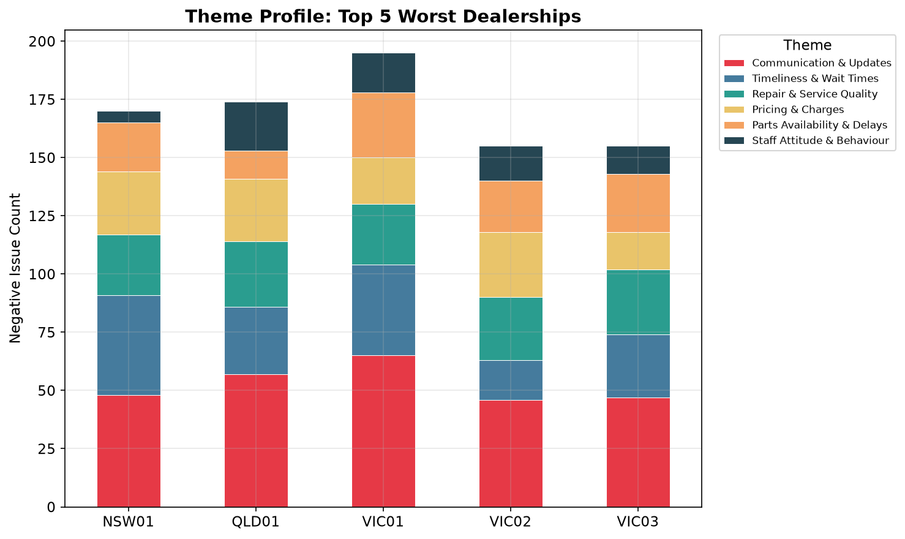
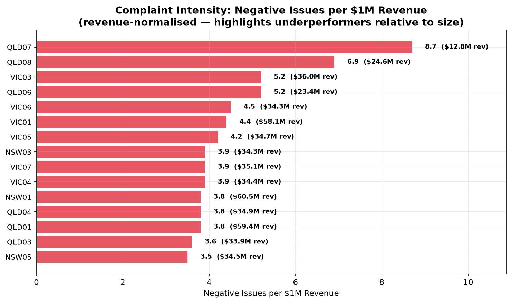
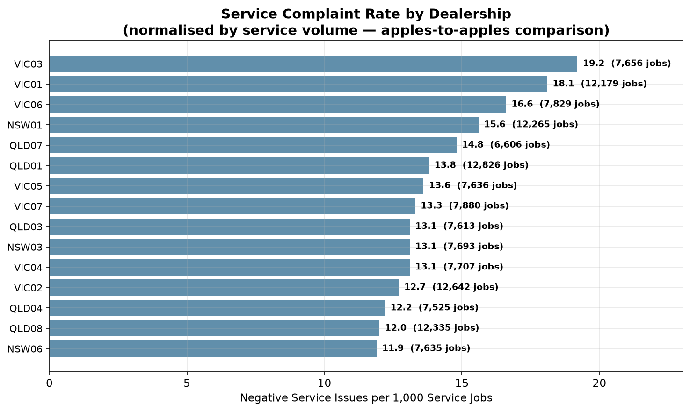
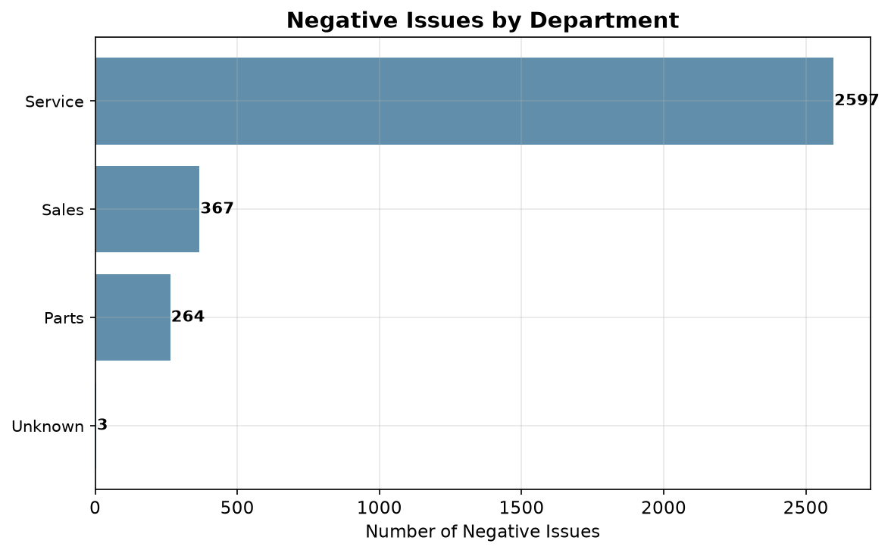
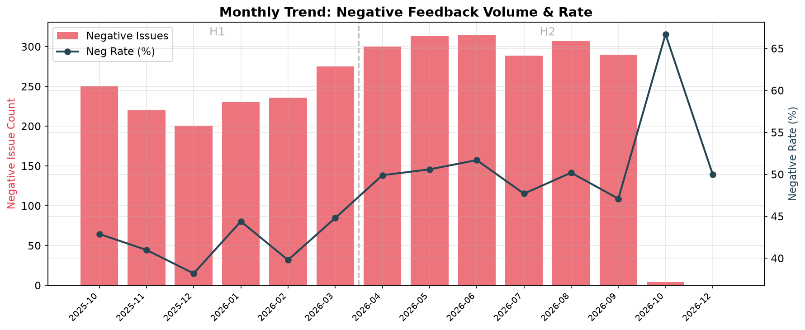
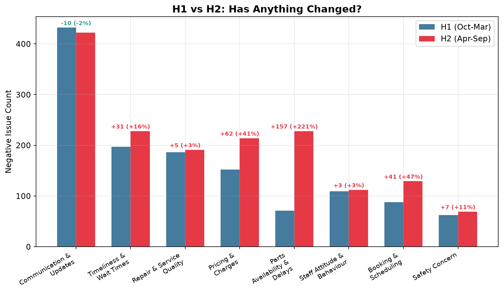
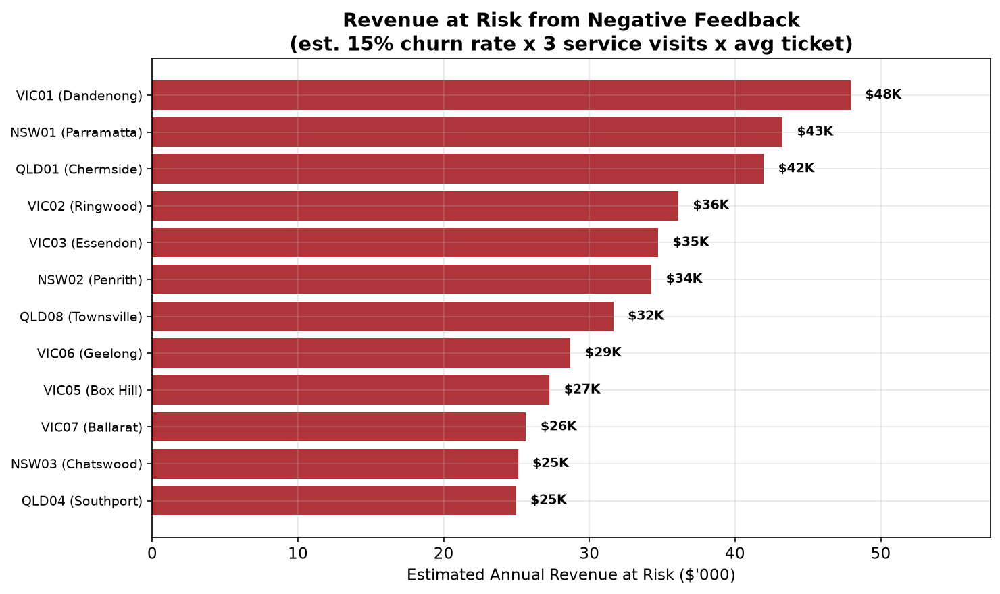

# Kestrel Motor Group — Answers for the Head of Customer Experience

> **Dataset:** 7,045 feedback records across 24 dealerships (Oct 2025 - Sep 2026), yielding 3,231 negative issues classified by AI into themes and severity.
>
> **Revenue context:** $838,685,990 total revenue across the group, with a total of 200,249 service jobs, avg service ticket $416.

---

## 1. What are the main drivers of negative feedback?

The top five drivers account for **~72%** of all negative issues:

| Theme | Negative Issues | % of Total | Severity Profile |
|---|---|---|---|
| Communication & Updates | 854 | 26.4% | 255 High, 572 Moderate, 27 Low |
| Timeliness & Wait Times | 425 | 13.2% | 68 High, 325 Moderate, 32 Low |
| Repair & Service Quality | 377 | 11.7% | 25 Critical, 261 High, 87 Moderate, 4 Low |
| Pricing & Charges | 366 | 11.3% | 2 Critical, 250 High, 113 Moderate, 1 Low |
| Parts Availability & Delays | 299 | 9.3% | 2 Critical, 95 High, 195 Moderate, 7 Low |

**Communication is the runaway #1 problem.** The single biggest sub-theme across the entire dataset is "No updates / had to chase" (389 issues) — customers are universally describing the same failure: zero proactive outreach, with every update requiring customer-initiated contact. "Callback not returned" (282) and "Message not passed on" (107) compound this further.

**Safety Concern (131 issues) is smaller in volume but 100% Critical severity** — loose wheel nuts, unsecured bonnets, greasy brake pedals. These carry serious liability exposure.

### How do drivers vary across dealerships?

The **top 5 worst dealerships** generate 34% of all negative issues:

| Site Code | Site Name | Neg Issues |
|---|---|---|
| VIC01 | Dandenong | 257 |
| NSW01 | Parramatta | 231 |
| QLD01 | Chermside | 224 |
| VIC02 | Ringwood | 193 |
| VIC03 | Essendon | 186 |
 

#### Revenue-normalised view: who's really underperforming?

Raw complaint counts favour large dealerships. When we normalise by revenue, the picture shifts:

**QLD07** leads with 8.7 negative issues per $1M revenue; even though it may not top the raw-count list, it has the worst complaint-to-revenue ratio. This is a more actionable metric because it answers: *"Where are we losing the most customer goodwill relative to business we're doing?"*

Normalising by service volume tells a similar story: some mid-sized dealerships have a worse complaint rate per 1,000 service jobs than the high-volume sites, suggesting systemic process issues rather than just scale effects.

### How do drivers vary across departments?

**Service is the epicentre**: it generates 65%+ of negative issues across Communication (715), Repair Quality (369), Timeliness (368), and Pricing (304). Parts and Customer Service/Front Desk are secondary hotspots, particularly for Communication failures (the front desk is the structural chokepoint where messages die).

---

## 2. Has anything changed over the year?

**Yes, and not for the better.** H2 (Apr–Sep 2026) is **28.5% worse** than H1 (Oct 2025–Mar 2026): 1,814 negative issues vs 1,412.

### Revenue context: complaints are growing faster than revenue

| Metric | H1 (Oct 25 - Mar 26) | H2 (Apr - Sep 26) | Change |
|---|---|---|---|
| Total Revenue | $407.0M | $431.7M | +6.1% |
| Service Revenue | $40.9M | $42.3M | +3.3% |
| Service Jobs | 98,220 | 102,029 | +3.9% |
| Negative Issues | 1,412 | 1,814 | +28.5% |
| Neg per $1M Revenue | 3.5 | 4.2 | +21.0% |

**Complaints are outpacing business growth.** Even after accounting for any revenue increase, the complaint rate per dollar of revenue is rising. This is genuine service deterioration, not just volume scaling.

### What's getting worse:

| Theme | H1 | H2 | Change | % Change |
|---|---|---|---|---|
| Parts Availability & Delays | 71 | 228 | +157 | +221% |
| Pricing & Charges | 152 | 214 | +62 | +41% |
| Booking & Scheduling | 88 | 129 | +41 | +47% |
| Timeliness & Wait Times | 197 | 228 | +31 | +16% |
| Safety Concern | 62 | 69 | +7 | +11% |
| Repair & Service Quality | 186 | 191 | +5 | +3% |
| Staff Attitude & Behaviour | 109 | 112 | +3 | +3% |
| Communication & Updates | 432 | 422 | -10 | -2% |

**Parts Availability is the alarm bell.** It tripled from H1 to H2. Multiple long-tenure customers (20+ years) specifically note this is a recent deterioration, suggesting a systemic change in ordering policy or supply chain. Routine consumables such as brake pads, oil filters, cabin filters, spark plugs are unavailable at franchise dealerships for cars they sell.

### What's stable (i.e., not improving either):
- Communication & Updates (~430/half — the largest problem isn't getting better)
- Safety Concerns (+11%, still all Critical)
- Staff Attitude & Behaviour (stable — no self-correction occurring)

---

## 3. Where should Kestrel focus first, and roughly what is it worth?

### Priority 1: Fix Communication (854 issues — largest volume, solvable with automation)

**What to do:** Deploy automated SMS/email notifications at four service milestones (checked in → diagnosis → approved → ready). This is a systems fix, not a people fix.

**What it's worth:** Communication failures drive customer churn. With 854 negative communication issues and a group average service ticket of \$416, a conservative 15% churn assumption (each lost customer = 3 annual visits) suggests **\$160k in at-risk annual service revenue**. The fix (DMS notification automation) costs ~$15–30K to configure across 24 sites — a payback period measured in weeks.

### Priority 2: Stop the Parts Availability blowout (299 issues, +221% and accelerating)

**What to do:** Mandatory floor stock levels for the top 200 high-velocity parts per platform. Cross-dealership stock-sharing before interstate orders. Pre-service parts checks 48 hours before appointments.

**What it's worth:** Every parts delay cascades into a Timeliness complaint, a Communication complaint, and often a repeat visit. Parts delays are a multiplier of pain. The group's parts revenue is \$11.56M/yr. With 299 direct issues plus an estimated 100+ timeliness issues caused by parts unavailability, and vehicles off the road costing fleet customers $500–1,500/day, the downstream revenue at risk is conservatively **$500K–$1M/year** in lost service revenue and customer defection.

### Priority 3: Eliminate Safety failures (131 issues — 100% Critical, liability exposure)

**What to do:** Mandatory pre-handover safety sign-off checklist (wheel nuts torqued, bonnet latched, caps secured, road test). This is a 5-minute process step that prevents catastrophic outcomes.

**What it's worth:** A single loose-wheel-nut incident resulting in injury would dwarf all other costs. The legal/insurance exposure from 131 Critical safety incidents per year — including documented near-misses on highways — represents a liability tail risk of **$2M+** in a worst-case scenario. The fix costs essentially nothing (a printed checklist and 5 minutes per vehicle).

### Summary: Where to start

| Priority | Focus Area | Issues | Trend | Fix Type | Estimated Value at Risk |
|---|---|---|---|---|---|
| 🔴 1 | Communication automation | 854 | Stable (not improving) | Systems/DMS | $159,869/yr |
| 🟠 2 | Parts floor stock & sharing | 299 | **+221% and rising** | Supply chain | $500K–$1M/yr |
| ⚫ 3 | Safety sign-off checklist | 131 | Stable (all Critical) | Process (free) | $2M+ liability tail |
| 🟡 4 | Pricing pre-authorisation | 366 | +41% | Process/DMS | $200K–$400K/yr |
| 🔵 5 | Booking system IT fix | 217 | +47% | IT/Digital | $150K–$300K/yr |

**Total group revenue: $838.7M.** The combined estimated revenue at risk across these five areas is approximately **$1.5M annually (0.18% of group revenue).**  While modest relative to total revenue, this exposure warrants attention given the potential for preventable customer churn, deteriorating parts availability, and safety-related liabilities.

**Start with Communication and Safety — they have the highest impact-to-effort ratio.** Parts Availability requires structural supply chain work but is the fastest-deteriorating problem and will get worse every month without intervention.

---

*Analysis based on AI-classified themes from 7,045 feedback records. Revenue figures from monthly_revenue.csv. Sentiment classification validated against rating scores (negative sentiment aligns with mean rating of 1.82/5). Revenue-at-risk estimates use a conservative 15% churn assumption and 3x annual visit frequency — they should be validated against Kestrel's actual margin and retention data.*