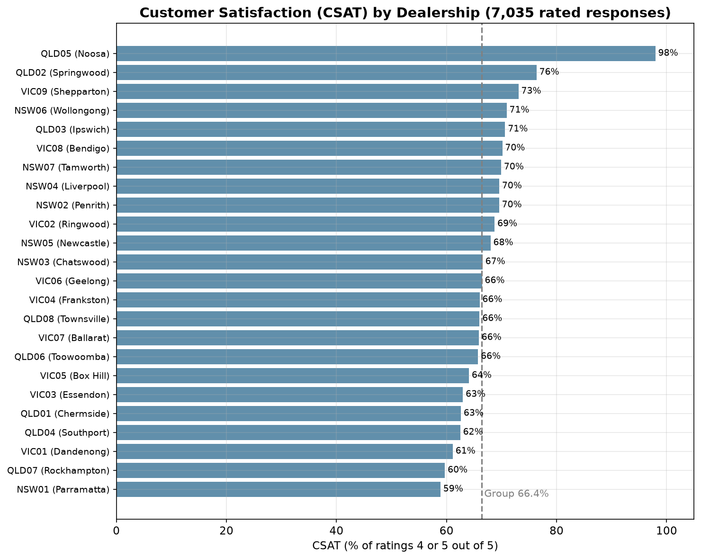
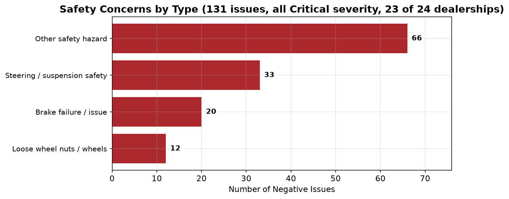

# Kestrel Motor Group — Dealer Customer Satisfaction Performance Analysis

## Business context

Kestrel Motor Group runs 24 dealerships across Victoria, New South Wales and Queensland, selling and servicing several vehicle brands. Over the year it sold 16,011 vehicles and completed 200,249 service jobs, for \$838.7M in revenue. Around 89% of that revenue comes from vehicle sales, but the service relationship is what brings customers back. Each dealership records feedback in its own format, so head office has had no group-wide view of what customers are saying. This analysis brings that feedback together to show what drives dissatisfaction, how it has changed, and where to act first.

**How priorities are ranked:** Safety first, then financial impact, then customer loyalty, then efficiency.

> **Dataset:** 7,045 feedback records across 24 dealerships (Oct 2025 - Sep 2026), yielding 3,231 negative issues classified by AI into themes and severity.
>
> **Revenue context:** $838,685,990 total revenue across the group, with a total of 200,249 service jobs, avg service ticket $416.

---

## Overall customer satisfaction

- **Group CSAT is 66.4%**: two in three rated responses score 4 or 5 out of 5 (7,035 responses).
- **It is falling:** 69.3% in H1 to 63.7% in H2, matching the rise in negative feedback (section 2).
- **The spread is narrow:** most dealerships sit between 59% (Parramatta) and 76% (Springwood), so dissatisfaction is group-wide rather than confined to a few sites. Noosa's 98% comes from only 49 feedback cards and is likely to be self-selected.

---

## 1. What are the main drivers of negative feedback?

The top five causes account for **~72%** of all negative issues:

| Theme | Negative Issues | % of Total | Severity Profile |
|---|---|---|---|
| Communication & Updates | 854 | 26.4% | 255 High, 572 Moderate, 27 Low |
| Timeliness & Wait Times | 425 | 13.2% | 68 High, 325 Moderate, 32 Low |
| Repair & Service Quality | 377 | 11.7% | 25 Critical, 261 High, 87 Moderate, 4 Low |
| Pricing & Charges | 366 | 11.3% | 2 Critical, 250 High, 113 Moderate, 1 Low |
| Parts Availability & Delays | 299 | 9.3% | 2 Critical, 95 High, 195 Moderate, 7 Low |

**Communication is the biggest driver of negative feedback by volume**, but it is not the No.1 priority (see Safety below). The single biggest sub-theme across the entire dataset is "No updates / had to chase" (389 issues) — customers are universally describing the same failure: zero proactive outreach, with every update requiring customer-initiated contact. "Callback not returned" (282) and "Message not passed on" (107) compound this further.

**Safety Concern (131 issues) is smaller in volume but 100% Critical severity** — loose wheel nuts, unsecured bonnets, greasy brake pedals. While the themes above are the leading causes of negative sentiment, the analysis has surfaced a potentially serious business risk: safety issues that could be life-threatening to customers and other road users. These carry serious legal, compliance and reputational risk, from compensation claims and penalties to, in the worst case, the shutdown of the business. The volume is small, but with 131 reported in a year (2–3 a week) the probability of a serious incident is high, the impact is very high, and the failures are preventable. **This makes Safety the No.1 priority (see section 3).**

### How do drivers vary across dealerships?

The **top 5 worst dealerships** generate 34% of all negative issues:

| Site Code | Site Name | Neg Issues |
|---|---|---|
| VIC01 | Dandenong | 257 |
| NSW01 | Parramatta | 231 |
| QLD01 | Chermside | 224 |
| VIC02 | Ringwood | 193 |
| VIC03 | Essendon | 186 |
 

#### Revenue-normalised view: who's really underperforming?

Raw complaint counts favour large dealerships. When we normalise by revenue, the picture shifts:

**QLD07** leads with 8.7 negative issues per $1M revenue; even though it may not top the raw-count list, it has the worst complaint-to-revenue ratio. This is a more actionable metric because it answers: *"Where are we losing the most customer goodwill relative to business we're doing?"*

Normalising by service volume tells a similar story: some mid-sized dealerships have a worse complaint rate per 1,000 service jobs than the high-volume sites, suggesting systemic process issues rather than just scale effects.

### How do drivers vary across departments?

**Service is the epicentre**: it generates 80%+ of negative issues across Communication (715), Repair Quality (369), Timeliness (368), and Pricing (304). Parts and Customer Service/Front Desk are secondary hotspots, particularly for Communication failures (the front desk is the structural chokepoint where messages die).

---

## 2. Has anything changed over the year?

**Yes, and not for the better.** H2 (Apr–Sep 2026) is **28.8% worse** than H1 (Oct 2025–Mar 2026): 1,819 negative issues vs 1,412.

### Revenue context: complaints are growing faster than revenue

| Metric | H1 (Oct 25 - Mar 26) | H2 (Apr - Sep 26) | Change |
|---|---|---|---|
| Total Revenue | $407.0M | $431.7M | +6.1% |
| Service Revenue | $40.9M | $42.3M | +3.3% |
| Service Jobs | 98,220 | 102,029 | +3.9% |
| Negative Issues | 1,412 | 1,819 | +28.8% |
| Neg per $1M Revenue | 3.5 | 4.2 | +21.4% |

**Complaints are outpacing business growth.** Even after accounting for any revenue increase, the complaint rate per dollar of revenue is rising. This is genuine service deterioration, not just volume scaling.

### What's getting worse:

| Theme | H1 | H2 | Change | % Change |
|---|---|---|---|---|
| Parts Availability & Delays | 71 | 228 | +157 | +221% |
| Pricing & Charges | 152 | 214 | +62 | +41% |
| Booking & Scheduling | 88 | 129 | +41 | +47% |
| Timeliness & Wait Times | 197 | 228 | +31 | +16% |
| Safety Concern | 62 | 69 | +7 | +11% |
| Repair & Service Quality | 186 | 191 | +5 | +3% |
| Staff Attitude & Behaviour | 109 | 112 | +3 | +3% |
| Communication & Updates | 432 | 422 | -10 | -2% |

**Parts Availability is the alarm bell.** It tripled from H1 to H2. Multiple long-tenure customers (20+ years) specifically note this is a recent deterioration, suggesting a systemic change in ordering policy or supply chain. Routine consumables such as brake pads, oil filters, cabin filters, spark plugs are unavailable at franchise dealerships for cars they sell.

### What's stable (i.e., not improving either):
- Communication & Updates (~430/half — the largest problem isn't getting better)
- Safety Concerns (+11%, still all Critical)
- Staff Attitude & Behaviour (stable — no self-correction occurring)

---

## 3. Where should Kestrel focus first, and roughly what is it worth?

### Priority 1: Eliminate Safety failures (131 issues — 100% Critical, liability exposure)

Safety issues come from 23 of 24 dealerships, so this is a group-wide process gap, not one bad workshop. 90% (118) are in Service. Half are "other" hazards, such as headlights left aimed into the trees, cruise control cutting out on the highway, or overheating after a service. The rest are steering/suspension (33), brakes (20) and loose wheel nuts (12). They are not falling: 62 in H1, 69 in H2.

> **Potential impact of one serious incident.** A single injury caused by a service failure could cost more than every other issue in this report combined.
> - **Lawsuit / compensation:** Victoria's TAC paid an average of about \$2.25M per serious-injury claim in 2021–22 ([Law Partners, citing TAC data](https://lawpartners.com.au/blog/tac-compensation-calculator)).
> - **Legal and compliance:** under the Australian Consumer Law, services must be provided with due care and skill, and customers can claim compensation when they are not ([ACCC](https://www.accc.gov.au/consumers/buying-products-and-services/consumer-rights-and-guarantees)). ACL penalties for companies now reach the greatest of \$50M, three times the benefit gained, or 30% of adjusted turnover ([Gadens](https://www.gadens.com/insights/increased-competition-and-consumer-law-penalties-now-take-effect)).
> - **Brand reputation:** about half of consumers avoid a business after reading negative reviews (BrightLocal 2025, [via Review42](https://resources.review42.com/online-reputation-management-statistics/)). A safety incident at one site would damage trust in all 24.

**What to do:** Mandatory pre-handover safety sign-off checklist (wheel nuts torqued, bonnet latched, caps secured, road test). This is a 5-minute process step that prevents catastrophic outcomes.

**What it's worth:** We assume one serious-injury claim at the TAC average, **~\$2.25M** (assumption; the data cannot predict whether an incident will happen). That alone is over seven times the at-risk revenue of the other four priorities combined (~\$302K/yr). The fix costs essentially nothing (a printed checklist and 5 minutes per vehicle).

### Priority 2: Fix Communication (854 issues — largest volume, solvable with automation)

**What to do:** Deploy automated SMS/email notifications at four service milestones (checked in → diagnosis → approved → ready). This is a systems fix, not a people fix.

**What it's worth:** Communication failures drive customer churn. With 854 negative communication issues from 778 customers and a group average service ticket of \$416, a conservative 15% churn assumption (each lost customer = 3 annual visits) suggests **\$145k in at-risk annual service revenue**. The fix (DMS notification automation) costs ~$15–30K (assumption) to configure across 24 sites — a payback period measured in weeks.

### Priority 3: Stop the Parts Availability blowout (299 issues, +221% and accelerating)

**What to do:** Mandatory floor stock levels for the top 200 high-velocity parts per platform. Cross-dealership stock-sharing before interstate orders. Pre-service parts checks 48 hours before appointments.

**What it's worth:** Every parts delay cascades into a Timeliness complaint, a Communication complaint, and often a repeat visit. Parts delays are a multiplier of pain. The group's parts revenue is \$11.56M/yr. With 299 direct issues from 275 customers (plus 21 timeliness issues in the same comments), the same churn method gives **~$51K/year** in at-risk service revenue. This excludes the cost of vehicles off the road for fleet customers (assumed $500–1,500/day), which falls on the customer rather than Kestrel.

### Summary: Where to start

| Priority | Focus Area | Issues | Trend | Fix Type | Estimated Value at Risk |
|---|---|---|---|---|---|
| 🔴 1 | Safety sign-off checklist | 131 | Stable (all Critical) | Process (free) | $2,250,000 per serious-injury claim (assumption) |
| 🟠 2 | Communication automation | 854 | Stable (not improving) | Systems/DMS | $145,477/yr |
| 🟡 3 | Parts floor stock & sharing | 299 | **+221% and rising** | Supply chain | $51,422/yr |
| 🔵 4 | Pricing pre-authorisation | 366 | +41% | Process/DMS | $67,129/yr |
| ⚪ 5 | Booking system IT fix | 217 | +47% | IT/Digital | $37,585/yr |

**Total group revenue: $838.7M.** The combined estimated revenue at risk across these five areas is approximately **\$2.55M (0.30% of group revenue)**: one serious-injury claim for Safety (\$2.25M) plus ~\$302K a year across the other four.  While modest relative to total revenue, this exposure warrants attention given the potential for preventable customer churn, deteriorating parts availability, and safety-related liabilities.

**Start with Safety, then Communication.** Safety has the highest potential impact and costs almost nothing to fix; Communication has the largest volume and a fast payback. Parts Availability requires structural supply chain work but is the fastest-deteriorating problem and will get worse every month without intervention.

---

*Analysis based on AI-classified themes from 7,045 feedback records. Revenue figures from monthly_revenue.csv. Sentiment classification validated against rating scores (negative sentiment aligns with mean rating of 1.73/5). Revenue-at-risk estimates count each complaining customer once and use a conservative 15% churn assumption and 3x annual visit frequency — they should be validated against Kestrel's actual margin and retention data. The Safety liability (one serious-injury claim at the TAC average), DMS fix cost and fleet downtime figures are assumptions, not calculated from the data.*